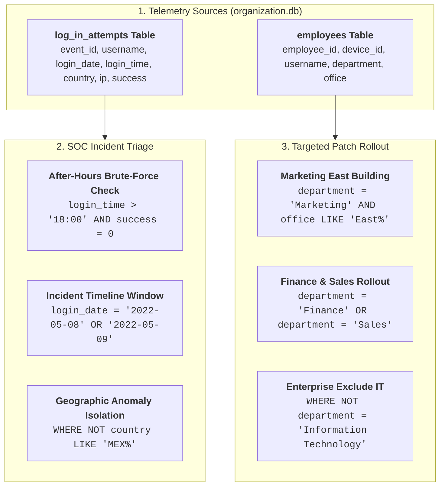

# 🛡️ SQL Security Incident Investigation & Asset Filtering Lab


---

## 📌 Project Overview & Academic Provenance

This practical cybersecurity lab is derived directly from the **Google Cybersecurity Professional Certificate** (*Course 4: Linux and SQL*).

In this project, a security analyst investigates suspicious login events across corporate authentication servers and scopes employee hardware assets for targeted vulnerability updates. The investigation leverages **Structured Query Language (SQL)** to filter relational databases (`organization.db` / MariaDB) using logical operators (`AND`, `OR`, `NOT`) and pattern matching (`LIKE`).

---

## 🎯 Security Investigation Objectives

| Investigation Task | SQL Filtering Logic | Cybersecurity Purpose |
| :--- | :--- | :--- |
| **After-Hours Failed Logins** | `login_time > '18:00' AND success = 0` | Identify off-hours brute-force or unauthorized credential stuffing. |
| **Multi-Day Incident Window** | `login_date = '2022-05-08' OR login_date = '2022-05-09'` | Reconstruct timeline leading to system compromise. |
| **Geographic Anomaly Isolation** | `NOT country LIKE 'MEX%'` | Filter domestic baseline and flag international foreign authentications. |
| **Targeted Patch: Marketing East** | `department = 'Marketing' AND office LIKE 'East%'` | Segment machines in specific physical buildings for hardware updates. |
| **Targeted Patch: Finance or Sales** | `department = 'Finance' OR department = 'Sales'` | Inventory workstations across departments requiring compliance software. |
| **Enterprise Rollout (Exclude IT)** | `NOT department = 'Information Technology'` | Prevent redundant deployments on pre-patched IT engineering devices. |

---

## 🏗️ Investigation Architecture



---

## 🧪 Hands-on Simulation Lab

A self-contained Python / SQLite reproduction suite is included to allow anyone to spin up the database and verify the SQL queries locally:

```bash
# 1. Initialize the SQLite database with lab datasets
python3 scripts/init_database.py

# 2. Execute the security queries
python3 scripts/run_security_queries.py
```

### Execution Telemetry Sample:

```text
======================================================================
🔍 1. Retrieve After-Hours Failed Login Attempts (> 18:00 and success = 0)
======================================================================
[SQL] SELECT * FROM log_in_attempts WHERE login_time > '18:00' AND success = 0;

event_id | username | login_date | login_time | country | ip_address | success
----------------------------------------------------------------------
2 | apatel | 2022-05-10 | 20:27:27 | CAN | 192.168.205.12 | 0
18 | pwashing | 2022-05-11 | 19:28:50 | US | 192.168.66.142 | 0
20 | tshah | 2022-05-12 | 18:56:36 | MEXICO | 192.168.109.50 | 0
28 | aestrada | 2022-05-09 | 19:28:12 | MEXICO | 192.168.27.57 | 0
42 | cgriffin | 2022-05-09 | 23:04:05 | US | 192.168.4.157 | 0
[+] Total rows returned: 19
```

---

## 📂 Repository Layout

```
├── README.md                                             # Executive portfolio documentation
├── reports/
│   └── SQL_SECURITY_INVESTIGATION_REPORT.md             # Formal incident triage & asset report
├── scripts/
│   ├── init_database.py                                  # Builds local SQLite replica of lab database
│   └── run_security_queries.py                           # Automated query runner and telemetry exporter
└── database/
    └── organization.db                                   # Pre-built lab database instance
```

---

## 👤 Author & Cybersecurity Portfolio

**Eduardo Souza Marques**  
- **GitHub:** [@edusouzamarques](https://github.com/edusouzamarques)  
- **Portfolio Showcase:** [edusouzamarques.github.io/cybersec](https://edusouzamarques.github.io/cybersec/)  
- **Certifications & Training:** Google Cybersecurity Professional Certificate, CompTIA Security+ SY0-701 Preparation
