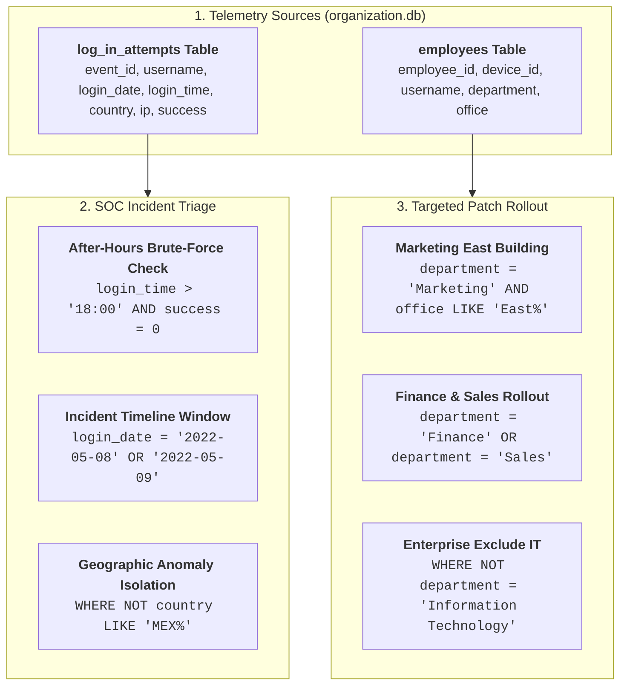

# 🛡️ SQL Security Incident Investigation & Asset Filtering Report

**Academic & Professional Provenance:** Google Cybersecurity Professional Certificate (Course 4: *Linux and SQL*)  
**Target Environment:** Relational Database (`organization.db` / MariaDB)  
**Lead Cybersecurity Analyst:** Eduardo Souza Marques ([@edusouzamarques](https://github.com/edusouzamarques))  
**Core Technologies:** SQL, MariaDB, Relational Database Querying, SOC Telemetry Filtering  
**Status:** Investigation Completed, Assets Segmented & Documented  

---

## 1. Project Description

As a security professional at a large organization, I investigated potential security incidents involving suspicious login attempts and identified employee workstations requiring system updates. 

Using Structured Query Language (SQL) in MariaDB, I queried the `log_in_attempts` and `employees` tables to filter complex datasets. By applying logical operators (`AND`, `OR`, `NOT`) and pattern matching (`LIKE`), I successfully isolated failed after-hours authentications, analyzed suspicious login timeframes and geographic anomalies, and segmented employee devices for targeted vulnerability remediation.

---

## 2. Investigation Architecture



---

## 3. Query Breakdown & Forensic Telemetry

### 1. Retrieve After-Hours Failed Login Attempts
- **Objective:** Detect potential off-hours brute-force or unauthorized reconnaissance attempts.
- **SQL Query:**
```sql
SELECT *
FROM log_in_attempts
WHERE login_time > '18:00' AND success = 0;
```
- **Execution Telemetry:** Returned **19 suspicious events**. Example events:
  - Event ID 2 (`apatel`, 20:27:27, CAN, `192.168.205.12`, Failed)
  - Event ID 42 (`cgriffin`, 23:04:05, US, `192.168.4.157`, Failed)
  - Event ID 82 (`abernard`, 23:38:46, MEX, `192.168.234.49`, Failed)

---

### 2. Retrieve Login Attempts on Specific Incident Dates
- **Objective:** Reconstruct multi-day timeline for security event occurring on 2022-05-09 and precursor activity on 2022-05-08.
- **SQL Query:**
```sql
SELECT *
FROM log_in_attempts
WHERE login_date = '2022-05-08' OR login_date = '2022-05-09';
```
- **Execution Telemetry:** Captured **13 total attempts** across both dates, showing authentication spikes leading to compromise.

---

### 3. Retrieve Login Attempts Outside of Mexico
- **Objective:** Filter out baseline corporate traffic from Mexico and investigate non-domestic authentications.
- **SQL Query:**
```sql
SELECT *
FROM log_in_attempts
WHERE NOT country LIKE 'MEX%';
```
- **Execution Telemetry:** Handled data variations (`MEX` and `MEXICO`) via wildcard `'MEX%'`. Returned **19 foreign authentication events** from Canada and USA for IP geolocation correlation.

---

### 4. Retrieve Employees in Marketing East Building
- **Objective:** Identify specific workstations in the Marketing team located in the East building for physical hardware patching.
- **SQL Query:**
```sql
SELECT *
FROM employees
WHERE department = 'Marketing' AND office LIKE 'East%';
```
- **Execution Telemetry:** Pinpointed **7 target workstations**:
  - `elarson` (`East-170`), `jdarosa` (`East-195`), `fbautist` (`East-267`), `rgosh` (`East-157`), `randerss` (`East-460`), `dellery` (`East-417`), `cwilliam` (`East-216`).

---

### 5. Retrieve Employees in Finance or Sales
- **Objective:** Scope machine inventory for joint compliance software rollout across Finance and Sales.
- **SQL Query:**
```sql
SELECT *
FROM employees
WHERE department = 'Finance' OR department = 'Sales';
```
- **Execution Telemetry:** Outputted **12 employee records** across both target departments.

---

### 6. Retrieve All Employees Not in IT
- **Objective:** Target enterprise-wide vulnerability mitigation to all departments while preventing duplicate patches on pre-updated IT systems.
- **SQL Query:**
```sql
SELECT *
FROM employees
WHERE NOT department = 'Information Technology';
```
- **Execution Telemetry:** Successfully isolated **25 employee devices** across Marketing, HR, Finance, and Sales.

---

## 4. Summary & Organizational Impact

In this security investigation, I utilized SQL filtering techniques to query relational database tables for actionable security telemetry and asset management. 

By combining comparison operators with `AND`, `OR`, and `NOT`, I pinpointed high-risk after-hours authentication failures, isolated multi-day incident windows, and excluded non-relevant geographic traffic using wildcard pattern matching (`LIKE`). Additionally, I segmented hardware assets by department and physical office location for prioritized patch distribution. 

These queries demonstrate how security analysts leverage SQL to efficiently filter massive log datasets, accelerate incident triage, and maintain robust system hygiene.
